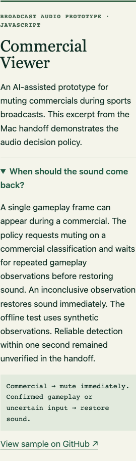

# Commercial Viewer · Audio decision policy

An AI-assisted prototype for muting commercials during sports broadcasts. The [Windows detector components](windows/README.md) include the break policy, correction handling, evidence collection, audio fingerprints and offline tests. The smaller example below comes from the original Mac handoff.

## Engineering decision

A single gameplay frame can appear during a commercial. The policy requests muting on a commercial classification and waits for repeated gameplay observations before restoring sound. An inconclusive observation restores sound immediately. The offline test uses synthetic observations. Reliable detection within one second remained unverified in the handoff.



## Run the standalone sample

Use Node.js 20 or newer from the repository directory. The sample uses the standard library and runs offline.

```sh
node mute-policy-test.mjs
```

Commercial → mute immediately. Confirmed gameplay or uncertain input → restore sound.

This repository contains the audio decision policy component of the larger project. I developed the project with AI assistance.

[Portfolio](https://Egrocket1.github.io) · [GitHub profile](https://github.com/Egrocket1)
